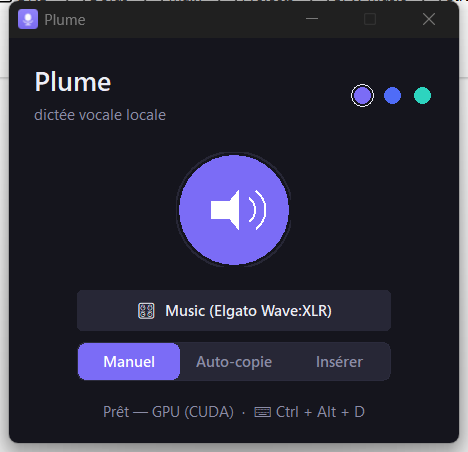

# Plume

Local, offline speech-to-text for Windows. Plume captures audio from your microphone
and/or from what the PC is playing (system loopback), transcribes it on-device with an
OpenAI Whisper model, and returns punctuated **French** text — ready to copy or to type
directly into the active window.

[](https://github.com/Mbensacq/plume/actions/workflows/ci.yml)


-76B900?logo=nvidia&logoColor=white)
[](LICENSE)

> Everything runs locally. After the Whisper model is downloaded once, the application
> works fully offline and no audio ever leaves the machine.

## Overview

Plume is a small desktop tool built around a single Tkinter window: pick one or more
audio sources, press record, and the transcribed text appears in a panel. It is tuned
for French dictation and preserves the punctuation Whisper infers from intonation and
pauses. It runs on the GPU when an NVIDIA card is available and falls back to the CPU
automatically otherwise.



## Features

- **Fully local & offline transcription** — audio is processed on-device; no cloud, no account.
- **Microphone and/or system-audio capture** via WASAPI loopback, with multiple sources mixed together (e.g. your mic plus a call).
- **GPU-accelerated** inference (NVIDIA CUDA, `float16`) with **automatic CPU fallback** (`int8`).
- **Punctuated French output** with light post-processing and user-defined word corrections (`plume_replacements.json`).
- **Live transcription (optional)** — instead of waiting for you to press stop, the text is transcribed and refined *as you speak*. Only a bounded, recent window is re-processed on each pass, so CPU/GPU load stays roughly constant and long dictations remain responsive.
- **Flexible output**: manual copy, clipboard auto-copy, or direct keystroke insertion into the active window, paired with a configurable **global hotkey** (default `Ctrl + Alt + D`, or a mouse side button). In insert mode the text is queued and typed only once a valid target window is focused — never into Plume's own window.
- **Optional AI rewrite** of the dictation through a local [Ollama](https://ollama.com) model (still 100 % on-device).
- **Model selector, themes and custom colour profiles** in the settings window; preferences are remembered between runs.
- **Clear error messages instead of stack traces** — missing model with no network, disk full, unplugged microphone, unavailable loopback device, oversized recording: each case is reported in plain language in the status bar and in `plume.log`.

## Tech stack

| Area | Technology |
|------|------------|
| Language | Python 3.11 – 3.13 (developed on 3.13) |
| Speech-to-text | [faster-whisper](https://github.com/SYSTRAN/faster-whisper) (CTranslate2 backend) running OpenAI Whisper models |
| Audio capture | [soundcard](https://github.com/bastibe/SoundCard) (WASAPI, microphones + output loopback) |
| Numerics | NumPy |
| Voice activity detection | onnxruntime (Silero VAD) |
| GPU acceleration | CUDA 12 + cuDNN 9 shipped as NVIDIA pip wheels — **no CUDA Toolkit and no PyTorch required** |
| GUI | Tkinter (standard library), DPI-aware, custom-drawn widgets rendered with Pillow |
| Platform integration | Win32 APIs via `ctypes` (global hotkey, key insertion, dark title bar) |
| Packaging | PyInstaller (portable Windows build, published through GitHub Releases) |
| Quality | pytest (76 tests, no audio hardware needed), ruff, GitHub Actions on Windows and Linux |

## Getting started

Two ways to run Plume:

| | Portable build | From source |
|---|---|---|
| Needs Python installed | No | Yes (3.11 – 3.13) |
| GPU acceleration | No (CPU only) | Yes, with an NVIDIA card |
| How | Download the zip from the [Releases](https://github.com/Mbensacq/plume/releases) page, unzip, run `Plume.exe` | Clone, run `install.bat` |

Either way, the Whisper model is downloaded on first launch (internet required once)
and cached locally; every later run is fully offline.

### Option A — portable build (no Python)

1. Download `Plume-<version>-windows-x64-cpu.zip` from the [Releases](https://github.com/Mbensacq/plume/releases) page.
2. Unzip it anywhere (a USB stick works) and double-click `Plume.exe`.
3. On first launch the `small` model (~485 MB) is downloaded into the `models\` folder next to the executable.

`Plume-console.exe` is the same application with a console window, useful to read
logs or to run `Plume-console.exe --selftest`. Windows SmartScreen may warn about the
unsigned executable: choose *More info → Run anyway*.

### Option B — from source

**Prerequisites**

- **Windows 10 or 11** (64-bit). Audio capture (WASAPI loopback), the global hotkey and direct key insertion rely on Windows-only APIs.
- **Python 3.11, 3.12 or 3.13** from [python.org](https://www.python.org/downloads/windows/), with *Add python.exe to PATH* and *tcl/tk and IDLE* ticked (the default). Python 3.10 is not supported by the pinned NumPy; 3.14 is untested.
- At least one **microphone** and/or **audio output** to capture.
- **Optional, for GPU acceleration:** an NVIDIA GPU with a recent driver (CUDA 12 compatible). The CUDA/cuDNN libraries are installed as pip wheels, so there is nothing else to install.

**Install (recommended: the script)**

```bat
git clone https://github.com/Mbensacq/plume.git
cd plume
install.bat
```

`install.bat` finds a suitable Python, creates `.venv`, installs the pinned
dependencies, detects an NVIDIA card (`nvidia-smi`) to choose between the CPU and GPU
requirement files, then runs the self-test, which downloads the model. Flags:
`--cpu`, `--gpu`, `--no-test`.

**Install (manual, PowerShell)**

```powershell
python -m venv .venv
.venv\Scripts\python -m pip install --upgrade pip
.venv\Scripts\python -m pip install -r requirements.txt        # CPU (~600 MB of packages)
# or, with an NVIDIA GPU:
.venv\Scripts\python -m pip install -r requirements-gpu.txt    # adds CUDA 12 / cuDNN 9 (~1.3 GB)
.venv\Scripts\python plume.py --selftest                        # downloads the model, checks the backend
```

All dependencies, including the inference engine (`ctranslate2`, `onnxruntime`, `av`,
`tokenizers`), are pinned to versions that ship Windows wheels for Python 3.11 – 3.13,
so nothing is compiled during installation. The same commands run on every push in
[CI](.github/workflows/ci.yml) on `windows-latest` (Python 3.11 and 3.13) and `ubuntu-latest`.

### What happens without an NVIDIA GPU

- With `requirements.txt` (CPU install) the GPU libraries are simply not installed. On startup Plume tries CUDA, the attempt fails immediately, and it loads the model on the CPU. The status bar shows `Prêt — CPU · small`.
- With `requirements-gpu.txt` but no usable GPU, the behaviour is the same (the CUDA wheels sit unused). Set `PLUME_DEVICE=cpu` to skip the CUDA attempt altogether.
- On CPU, Plume defaults to the `small` model instead of `large-v3`, which is far too slow without a GPU. You can pick another model in the settings window (gear icon) or with `PLUME_MODEL`.

### Whisper models

| Model | Download | Typical use |
|-------|----------|-------------|
| `tiny`, `base` | 75 MB, 145 MB | Very fast, rough French; used by the test suite |
| `small` | 485 MB | **Default on CPU** — usable live transcription on a modern laptop |
| `medium` | 1.5 GB | Better accuracy, slow on CPU |
| `large-v3-turbo` | 1.6 GB | Near large-v3 quality, several times faster |
| `large-v3` | 3.1 GB | **Default on GPU** — best accuracy |

Models are downloaded from Hugging Face and cached in `%USERPROFILE%\.cache\huggingface\hub`
(or `PLUME_MODEL_DIR`, or `models\` next to the portable executable). If the model is not
cached and there is no network, Plume explains it in a dialog and lets you retry or pick
an already-downloaded model.

## Configuration

Plume does not use a `.env` file. Behaviour is controlled by the settings window, a
few environment variables and two JSON files.

Environment variables (all optional):

| Variable | Effect |
|----------|--------|
| `PLUME_MODEL` | Force a Whisper model (`large-v3`, `large-v3-turbo`, `medium`, `small`…). Overrides the settings window. |
| `PLUME_MODEL_DIR` | Directory used to download/cache the model. |
| `PLUME_DEVICE` | Set to `cpu` to force CPU and skip the GPU attempt. |
| `PLUME_AI_URL`, `PLUME_AI_MODEL` | Ollama endpoint and model for the AI rewrite mode (default `http://localhost:11434`, `llama3.1:8b`). |

Files next to `plume.py` (or next to `Plume.exe`):

| File | Purpose |
|------|---------|
| `plume_config.json` | Auto-generated preferences (theme, sources, output mode, live mode, model, hotkey). Safe to delete to reset. |
| `plume_replacements.json` | User-defined transcription corrections, e.g. `{ "git eub": "GitHub" }`. Case-insensitive, whole words; keys starting with `_` are ignored. An invalid file is reported in the status bar instead of silently disabling corrections. |
| `plume.log` | Log file (rotated at 1 MB). This is where to look when something goes wrong, since the app normally runs without a console. |

## Usage

### Run

```powershell
.venv\Scripts\python plume.py      # with a console (shows logs)
.venv\Scripts\pythonw plume.py     # without a console
```

Or double-click **`Plume.vbs`** (no console), or **`lancer.bat`** which **auto-updates
first** — it runs `git pull` (fast-forward), reinstalls dependencies only if a
requirements file changed, then starts the app. Both work offline (the update step is
skipped if git is unavailable).

**Live vs. on-stop.** The **En direct / À l'arrêt** switch selects *when* transcription
happens: *À l'arrêt* transcribes once when you press stop (with a progress indicator
for long recordings); *En direct* streams the text as you speak, refining it in place.

**Dictée / IA.** *IA* sends the finished dictation to a local Ollama model that fixes
grammar and phrasing while keeping the meaning. Requires Ollama running and the model
pulled; otherwise Plume says so and keeps the raw text.

**Settings (gear icon):** Whisper model, global hotkey (capture a key combination or
use a mouse side button), custom colour profiles, Ollama model.

Recordings are capped at two hours; the recording stops and is transcribed automatically
when the limit is reached, or as soon as every selected source has failed (e.g. the
microphone was unplugged).

### Self-test and tests

```powershell
.venv\Scripts\python plume.py --selftest       # loads the model, checks GPU/CPU, transcribes a synthetic buffer
.venv\Scripts\python -m pip install -r requirements-dev.txt
.venv\Scripts\python -m pytest                  # 76 tests, no audio hardware, no model download
.venv\Scripts\ruff check .
```

The tests cover text post-processing, the corrections file, the hallucination filter,
the live-transcription window (when text is frozen, what is displayed, which context is
fed back to the model), the recorder's mixing and bounded snapshots, user-facing error
messages, and a Tk smoke test that drives the window with a fake model.

## Troubleshooting

| Message / symptom | Meaning and fix |
|---|---|
| `Modèle « … » introuvable en local et pas de connexion internet` | First launch needs the network once to download the model. Connect, then click the central button to retry, or choose an already-downloaded model in the settings. |
| `Disque plein : impossible d'écrire le modèle` | Free space (see the model sizes above) or point `PLUME_MODEL_DIR` to another drive. |
| `Périphérique audio indisponible (micro débranché ou désactivé)` | Reconnect the device, then *Sources… → Actualiser*. |
| `Capture du son du PC impossible` | The selected output is unavailable for loopback (disabled, or in exclusive mode). Pick another output in *Sources…*. |
| `Accès au micro refusé` | Windows Settings → Privacy → Microphone → allow desktop apps. |
| `Prêt — CPU (GPU indisponible)` on a machine with an NVIDIA card | The CUDA attempt failed: check that the driver is recent (CUDA 12) and that `requirements-gpu.txt` was installed. Details in `plume.log`. |
| `Raccourci global indisponible` | Another application already registered the same hotkey. Choose another one in the settings. |
| No window at all | Run `.venv\Scripts\python plume.py` from a terminal, or `Plume-console.exe`, to see the error; startup failures also open a message box and are written to `plume.log`. |

## Building the portable version

```powershell
.\build_portable.ps1            # -> dist\Plume\ and dist\Plume-<version>-windows-x64-cpu.zip
.\build_portable.ps1 -Gpu       # also bundle CUDA/cuDNN if installed in the venv (~1.3 GB)
```

`Plume.spec` collects the native libraries of faster-whisper, CTranslate2, onnxruntime,
PyAV, tokenizers and soundcard into a one-folder build (~200 MB unpacked). The model is
never bundled: it is downloaded on first launch into `models\` next to the executable.

Pushing a tag such as `v1.0.1` runs the [release workflow](.github/workflows/release.yml):
it builds the bundle on `windows-latest`, runs `Plume-console.exe --selftest` on the frozen
executable, and attaches the zip to a GitHub release.

## Project structure

```text
.
├── plume.py                    # Application: core (model, capture, live session), UI, --selftest
├── tests/                      # pytest suite (no audio hardware, no model download)
├── requirements.txt            # Runtime dependencies, CPU (pinned)
├── requirements-gpu.txt        # + NVIDIA CUDA 12 / cuDNN 9 wheels
├── requirements-dev.txt        # pytest, ruff, PyInstaller
├── pyproject.toml              # Project metadata, pytest and ruff configuration
├── install.bat                 # One-click install: venv, dependencies, GPU detection, self-test
├── lancer.bat                  # Auto-updating launcher (git pull, then start)
├── Plume.vbs                   # Double-click launcher without console
├── Plume.spec                  # PyInstaller build definition
├── build_portable.ps1          # Local portable build + zip
├── plume_replacements.json     # User-defined transcription corrections (editable)
├── plume.ico                   # Application icon
├── docs/                       # Screenshot, portable-build readme
└── .github/workflows/          # ci.yml (lint + tests on Windows/Linux), release.yml (portable build)
```

`plume.py` is intentionally kept as a single file for trivial deployment; constants and
tunables sit at the top of the file.

## Roadmap

- Recording level (VU) meter.
- Session history of past dictations.
- In-app language selector (the pipeline is currently tuned for French).
- Signed portable executable.

## License

Released under the [MIT License](LICENSE).

## Author

**Mathis Bensacq** — https://github.com/Mbensacq
